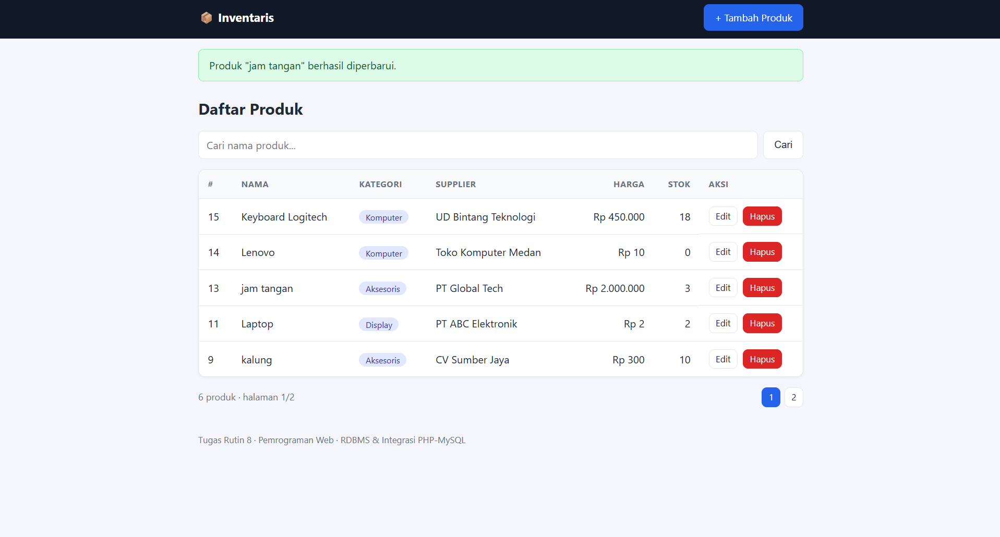
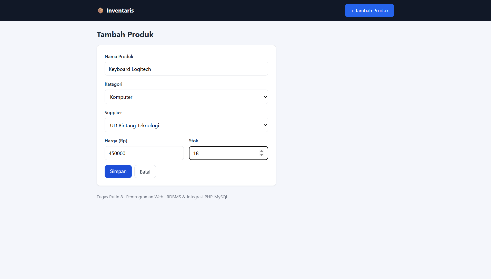
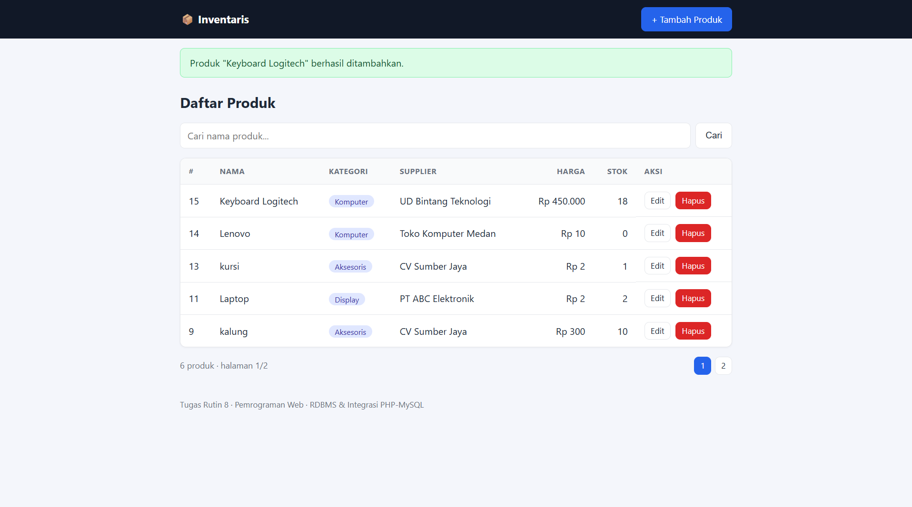
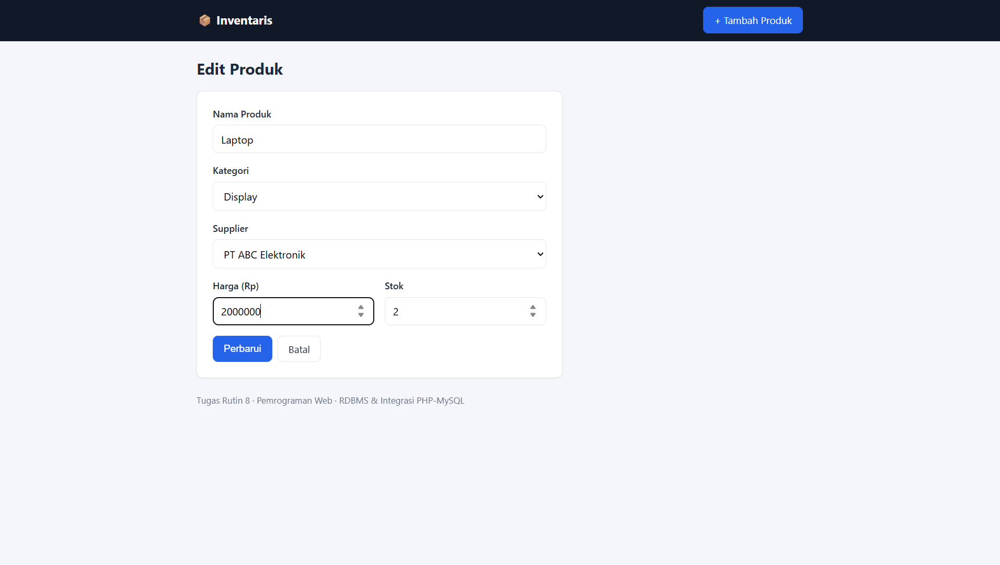
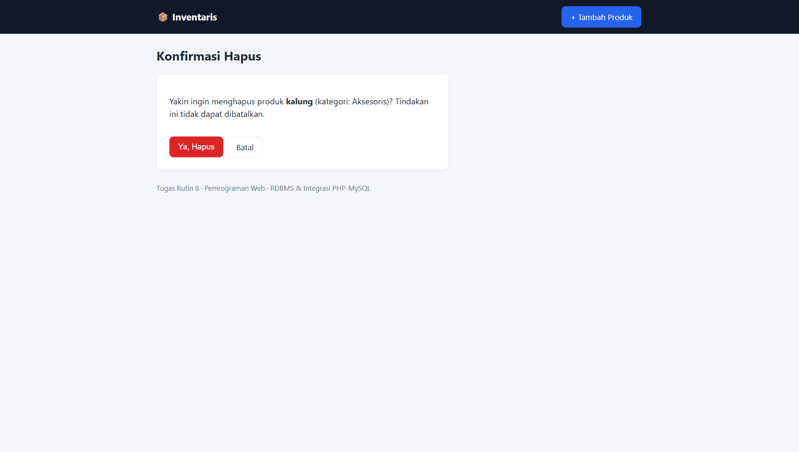
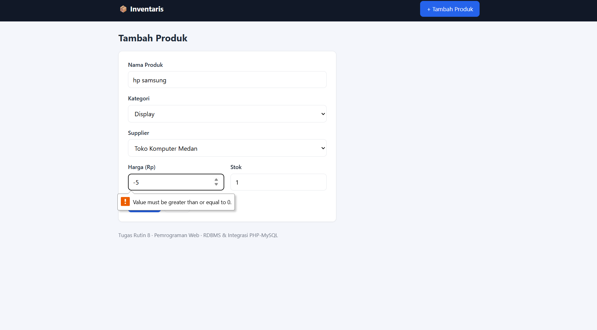
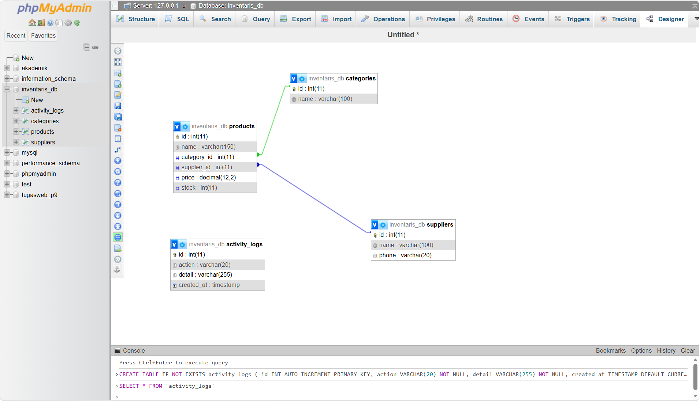
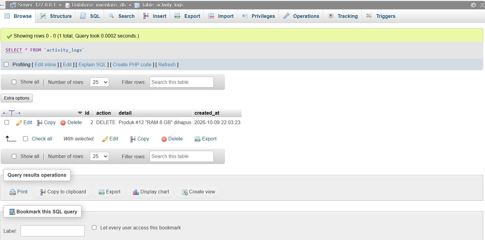

# CRUD Inventaris — Tugas Rutin 8

Aplikasi CRUD inventaris dengan **PHP native + MySQL (PDO)**.
Mata kuliah 3KOM40115 Pemrograman Web — Pertemuan 8 (RDBMS & Integrasi PHP-MySQL).

## Fitur
- Database `inventaris_db` dengan 3 tabel inti (`categories`, `suppliers`, `products`) + FK, normalisasi 3NF
- Minimal 5 data seed per tabel
- Koneksi PDO dengan **Singleton pattern** (`ERRMODE_EXCEPTION`, `FETCH_ASSOC`, `EMULATE_PREPARES=false`)
- List produk dengan JOIN (produk + kategori + supplier)
- Create (dropdown kategori & supplier), Update (form pre-filled), Delete (halaman konfirmasi)
- Semua query input memakai **prepared statements**
- Output HTML memakai `htmlspecialchars()` (helper `e()`)
- Flash message sukses/gagal (Post/Redirect/Get)
- Bonus: pencarian, pagination, transaction pada delete + tabel `activity_logs`, proteksi CSRF
- Kredensial database di file `.env` (tidak di-hardcode)

## Struktur
```
crud-inventaris/
├── config/database.php   (Singleton PDO)
├── includes/             (helpers, header, footer, form)
├── assets/style.css
├── schema.sql            (DDL + seed)
├── index.php   create.php   edit.php   delete.php
├── .env.example
└── README.md
```

## Langkah Import Database & Menjalankan
1. Install Laragon/XAMPP, jalankan Apache + MySQL (PHP 8.1+).
2. Salin folder proyek ini ke `htdocs` (XAMPP) atau `www` (Laragon).
3. Buka phpMyAdmin → **Import** → pilih `schema.sql` → Go.
   (atau terminal: `mysql -u root -p < schema.sql`)
4. Salin `.env.example` menjadi `.env`, sesuaikan `DB_USER` / `DB_PASS` bila perlu.
5. Buka `http://localhost/TugasWeb-Pertemuan8-CRUD/` di browser.

## Screenshot

### 1. Daftar Produk (JOIN produk + kategori + supplier)


### 2. Form Tambah Produk (dropdown kategori & supplier)


### 3. Flash Message Setelah Tambah


### 4. Form Edit (pre-filled)


### 5. Konfirmasi Hapus


### 6. Validasi Input


### 7. Relasi Database (phpMyAdmin Designer)


### 8. Log Aktivitas (Transaction pada Delete)


## Pengumpulan
Repo GitHub **public** bernama `TugasWeb-Pertemuan8-CRUD`, link dikumpulkan lewat LMS UNIMED.
